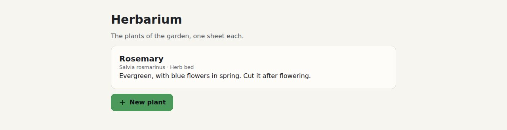
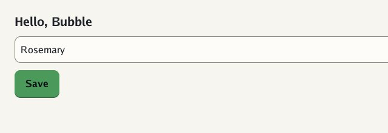

# 🚀 Getting started

This page is for someone who has never used Bubble. In ten minutes you will have a web page
wearing Bubble in your own colour, and the same look in a Go window.

## What you need

| For | You need |
|---|---|
| the web page | a browser and a text editor |
| your own colour | [Go](https://go.dev/dl/) 1.25 or newer |
| the Go window | Go, plus the OpenGL headers on Linux (see [Go UI's getting started](https://github.com/akrck02/go-ui/blob/main/docs/2-get-started.md)) |

Make a folder for this page's work, and get Bubble inside it. Until Bubble 4 reaches `main`, it
lives on the `feature/v4` branch:

```sh
mkdir bubble-start && cd bubble-start
git clone -b feature/v4 https://github.com/akrck02/bubble
```

Every command below runs from `bubble-start`, unless it says otherwise.

## 1. A web page in Bubble

Make a folder next to `bubble`, and copy Bubble's two CSS files into it:

```sh
mkdir hello-bubble
cp bubble/css/tokens.css bubble/css/bubble.css hello-bubble/
```

`tokens.css` holds the values (colours, sizes, corners). `bubble.css` holds the parts (buttons,
cards, fields) and reads only those values. Always load the tokens first.

Write `hello-bubble/index.html`:

```html
<!doctype html>
<html lang="en">
<head>
<meta charset="utf-8">
<title>Herbarium</title>
<link rel="stylesheet" href="tokens.css">
<link rel="stylesheet" href="bubble.css">
</head>
<body>
<main class="page">
  <h1>Herbarium</h1>
  <p class="soft">The plants of the garden, one sheet each.</p>
  <section class="card">
    <h2>Rosemary</h2>
    <p class="quiet">Salvia rosmarinus · Herb bed</p>
  </section>
  <p><button class="button primary" type="button">New plant</button></p>
</main>
</body>
</html>
```

Open it in your browser. **You should see** a page of an off-white, like paper, a card with a
fine line round it, and a blue button: Bubble's own blue.


## 2. Your own colour

Your project has a colour, probably the one in its logo. Bubble makes the tokens for it:

```sh
cd bubble
go run ./cmd/bubble-css -accent "#4C9A5B" > ../hello-bubble/tokens.css
cd ..
```

Reload the page. **You should see** the button in green, with dark text on it:



Bubble chose the dark text because white on this green would be hard to read. It checks every
colour it makes this way; [core ideas](3-core-ideas.md#the-accent) tells how.

## 3. The same look in a Go window

Bubble's Go module, `goui`, dresses [Go UI](https://github.com/akrck02/go-ui). For now Go UI is
taken from its repository, so clone it and Go Renderer next to Bubble:

```sh
git clone https://github.com/akrck02/go-ui
git clone https://github.com/akrck02/go-renderer
mkdir hello-go && cd hello-go
```

Write `go.mod`. Go UI and Bubble are not published as versions yet, so `replace` tells Go to
take each one from its folder instead. Go Renderer is listed too, because Go UI needs it:

```
module hello

go 1.25

require (
	github.com/akrck02/bubble v0.0.0
	github.com/akrck02/bubble/goui v0.0.0
	github.com/akrck02/go-ui v0.0.0
)

replace (
	github.com/akrck02/bubble => ../bubble
	github.com/akrck02/bubble/goui => ../bubble/goui
	github.com/akrck02/go-renderer => ../go-renderer
	github.com/akrck02/go-ui => ../go-ui
)
```

And `main.go`:

```go
// Command hello is the Go program of Bubble's getting started (docs/2-getting-started.md): a
// heading, a field and a button in Go UI, wearing Bubble with the herbarium's green.
package main

import (
	"flag"
	"log"

	"github.com/akrck02/bubble"
	"github.com/akrck02/bubble/goui"
	ui "github.com/akrck02/go-ui"
	"github.com/akrck02/go-ui/window"
)

func main() {
	accent, err := bubble.ParseColor("#4C9A5B")
	if err != nil {
		log.Fatal(err)
	}
	options := bubble.DefaultOptions()
	options.Accent = accent
	theme, err := bubble.NewTheme(options)
	if err != nil {
		log.Fatal(err)
	}
	windowOptions := window.Options{Title: "Hello, Bubble"}
	windowOptions.RegisterFlags(flag.CommandLine) // -dark, -capture and the rest
	flag.Parse()
	name := "Rosemary"
	err = window.Run(windowOptions, func(context *ui.Context) {
		context.Theme = goui.Theme(theme)
		context.Box(ui.Layout{Direction: ui.Vertical, Width: ui.Grow(), Padding: ui.Pad(24), Gap: 12}, func() {
			context.Heading("Hello, Bubble")
			context.TextField("name", &name)
			if context.PrimaryButton("Save") {
				log.Println("saved", name)
			}
		})
	})
	if err != nil {
		log.Fatal(err)
	}
}
```

Run it:

```sh
go mod tidy
go run .
```

`go mod tidy` downloads the few libraries Go UI uses (OpenGL and windowing bindings) and writes
`go.sum`. The first `go run` compiles them, which takes a minute.

**You should see** a window with the heading, a field and the same green button. Click *Save* and
the terminal prints `saved Rosemary`.



The program passes its flags to the window: `-dark` for the night, `-capture shot.png` to save
one frame as a picture and quit. Try `go run . -dark`: the window turns to Bubble's night. A darker colour would be lightened
there to stand out; this green already does.

## Where next

| You want to… | Go to |
|---|---|
| build a whole app, step by step | 🏴‍☠️ [The quest](4-the-quest/0-the-quest.md) |
| understand tokens and the accent | [Core ideas](3-core-ideas.md) |
| see every part you can use | [Components](6-reference/2-components.md) |
