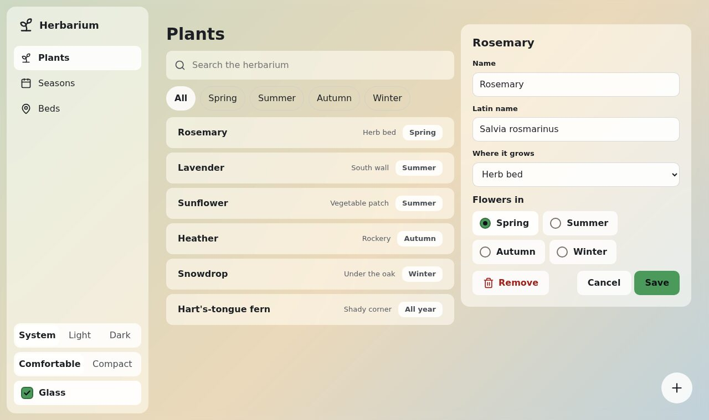

# 🏴‍☠️ The quest

This quest is for someone who learns best by building. Level by level, you will make a
**herbarium**: the plants of a garden, one sheet each. It starts as one web page and ends as the
same app in a Go window, in four looks.



## The map

| Level | You build | You learn |
|---|---|---|
| 1. [The first page](1-the-first-page.md) | a page with a card and a button | tokens and parts |
| 2. [The colour](2-the-colour.md) | the herbarium in its own green | how Bubble adjusts an accent |
| 3. [The index](3-the-index.md) | the app's frame, a search, a list | `.app`, `.sidebar`, `.list` |
| 4. [The sheet](4-the-sheet.md) | a plant's sheet to edit | fields, choices, buttons |
| 5. [Night and density](5-night-and-density.md) | a switch for dark and compact | the attributes on `<html>` |
| 6. [Glass](6-glass.md) | frosted panes over a wallpaper | the glass finish |
| 7. [To the desktop](7-to-the-desktop.md) | the herbarium in Go UI | `bubble.NewTheme` and `goui.Theme` |
| 8. [Material](8-material.md) | the herbarium for Android eyes | switching style without touching parts |

Levels 1 to 6 need a browser and a text editor. Level 2 and levels 7 and 8 need
[Go](https://go.dev/dl/).

## Before you start

Clone Bubble, and make a folder for the herbarium next to it:

```sh
git clone -b feature/v4 https://github.com/akrck02/bubble
mkdir herbarium
cp bubble/css/tokens.css bubble/css/bubble.css herbarium/
```

Each level ends with the finished file in
[`examples/herbarium`](https://github.com/akrck02/bubble/tree/feature/v4/examples/herbarium). If
you get lost, open it and compare. Those files load `bubble.css` from the repository's `css/`
folder; yours load the copy next to them.

Ready? ⛵ [Level 1: the first page](1-the-first-page.md)
