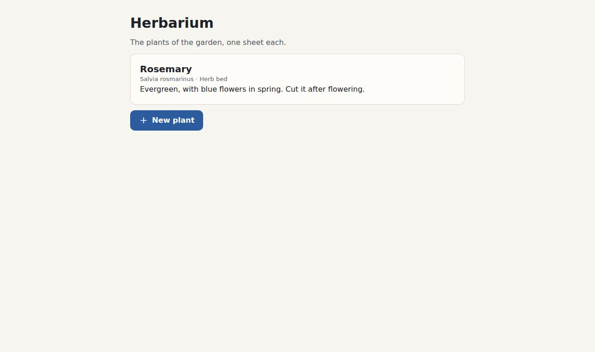

# 1. 📄 The first page

**Goal:** a page that wears Bubble, with a title, a card and a button.

## Two files, always in this order

Create `herbarium/index.html`:

```html
<!doctype html>
<html lang="en">
<head>
<meta charset="utf-8">
<meta name="viewport" content="width=device-width, initial-scale=1">
<title>Herbarium</title>
<link rel="stylesheet" href="tokens.css">
<link rel="stylesheet" href="bubble.css">
</head>
<body>
<main class="page">
  <h1>Herbarium</h1>
  <p class="soft">The plants of the garden, one sheet each.</p>
</main>
</body>
</html>
```

`tokens.css` defines the values; `bubble.css` uses them. The page would still load the other way
round, but the parts would find no values to read.

`.page` is a column of reading width, with room around it. `.soft` is secondary text.

## A card and a button

Inside `<main>`, after the paragraph, add:

```html
<section class="card">
  <h2>Rosemary</h2>
  <p class="quiet">Salvia rosmarinus · Herb bed</p>
  <p>Evergreen, with blue flowers in spring. Cut it after flowering.</p>
</section>
<p><button class="button primary" type="button">New plant</button></p>
```

- `.card` is a surface with a fine line and rounded corners.
- `.quiet` is the smallest, palest text: hints and captions.
- `.button.primary` is the main action. A page has one.

## ✅ Checkpoint

Open `index.html`. **You should see:**



The blue is Bubble's own. Its finished file is `examples/herbarium/1-first-page.html`.

## What you learned

- Bubble is two files: tokens, then parts.
- Parts are classes on ordinary HTML: `card`, `button primary`, `soft`, `quiet`.

Next: 🎨 [Level 2: the colour](2-the-colour.md)
