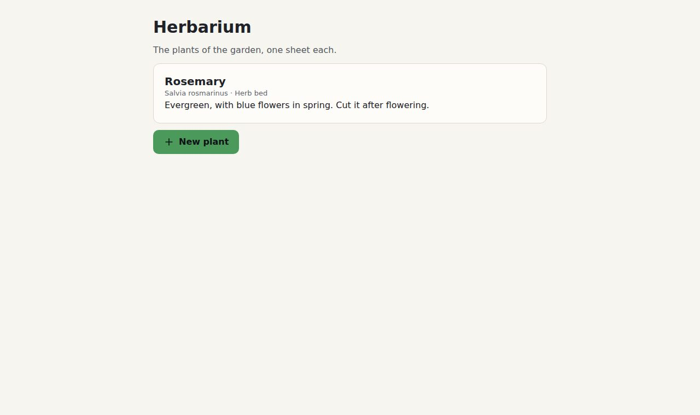

# 2. 🎨 The colour

**Goal:** the herbarium in its own green, with every text still easy to read.

## Make the tokens for your colour

A herbarium is green. From the folder that holds `bubble` and `herbarium`:

```sh
cd bubble
go run ./cmd/bubble-css -accent "#4C9A5B" > ../herbarium/tokens.css
cd ..
```

`bubble-css` writes every token for this accent: light and dark, paper and material, both
densities. Never edit `tokens.css` by hand; make it again instead.

## ✅ Checkpoint

Reload the page. **You should see** the button in green:



Look closely at the button's text. It is dark, not white.

## Why dark text?

White on this green has a contrast of about 3.4. Text needs 4.5 to be easy to read, the level the
web's accessibility guidelines (WCAG) ask for. Bubble tried both: darkening the green until white
read, or keeping it with dark text. A green that keeps its colour won.

Try a darker colour, such as `#2E5E3A`. The text turns white, and the green stays as it is.

- [Core ideas: the accent](../3-core-ideas.md#the-accent) explains the steps.
- [Your logo's colour](../5-guides/1-the-accent.md) shows how to see what Bubble made.

## What you learned

- One command makes the tokens for any colour.
- Bubble moves the colour, or changes the text on it, until everything reads.

Next: 🗂️ [Level 3: the index](3-the-index.md)
