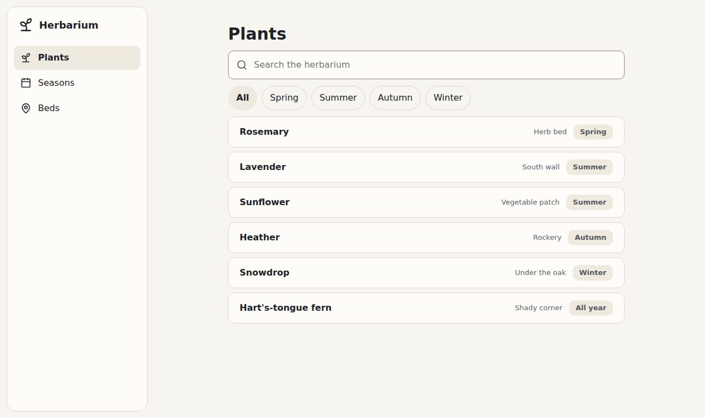

# 3. 🗂️ The index

**Goal:** the app's frame, with an index on the left, a search, filters and the list of plants.

## The frame

Replace the whole `<body>` with Bubble's frame: `.app` holds an index (`.sidebar`) and the page.

```html
<body>
<div class="app">
  <aside class="sidebar">
    <a class="brand" href="#"><span>Herbarium</span></a>
    <nav class="places" aria-label="Places">
      <a href="#" aria-current="page"><span>Plants</span></a>
      <a href="#"><span>Seasons</span></a>
      <a href="#"><span>Beds</span></a>
    </nav>
  </aside>
  <main class="page">
    <h1>Plants</h1>
  </main>
</div>
</body>
```

- `.brand` is the app's name, and its logo when it has one.
- `.places` are the app's places. `aria-current="page"` marks where you are: it shows brighter
  and heavier, and screen readers say "current page".

Put an icon before each name if you like: an inline `<svg>` of 20 pixels. The finished file uses
[Lucide](https://lucide.dev)'s *sprout*, *calendar* and *map-pin*.

## Search and filters

Under the `<h1>`, add a search box and chips to filter by season:

```html
<div class="search" role="search">
  <label class="search-box"><input type="search" placeholder="Search the herbarium"
    aria-label="Search the herbarium"></label>
</div>
<nav class="chips" aria-label="Seasons">
  <a class="chip" href="#" aria-current="page">All</a>
  <a class="chip" href="#">Spring</a>
  <a class="chip" href="#">Summer</a>
  <a class="chip" href="#">Autumn</a>
  <a class="chip" href="#">Winter</a>
</nav>
```

## The list

Then the plants, as a `.list` of `.list-item`s:

```html
<ul class="list" aria-label="Plants">
  <li class="list-item"><span class="title">Rosemary</span>
    <span class="quiet">Herb bed</span><span class="pill">Spring</span></li>
  <li class="list-item"><span class="title">Lavender</span>
    <span class="quiet">South wall</span><span class="pill">Summer</span></li>
  <li class="list-item"><span class="title">Snowdrop</span>
    <span class="quiet">Under the oak</span><span class="pill">Winter</span></li>
</ul>
```

`.title` takes the room that is left, so the bed and the season line up on the right. A `.pill`
is a small label: a state, a tag.

## ✅ Checkpoint

**You should see** the index on the left and the list beside it:



Make the window narrower. Under 1024 pixels the index folds to its icons; under 640 it disappears,
and `.bottom-bar` would take its place on a phone. The finished file is `3-the-index.html`.

## What you learned

- `.app`, `.sidebar`, `.places` and `.page` make the frame of any app.
- What is chosen is marked with `aria-current`, never with a class: the look and the screen reader
  agree.

Next: 📝 [Level 4: the sheet](4-the-sheet.md)
