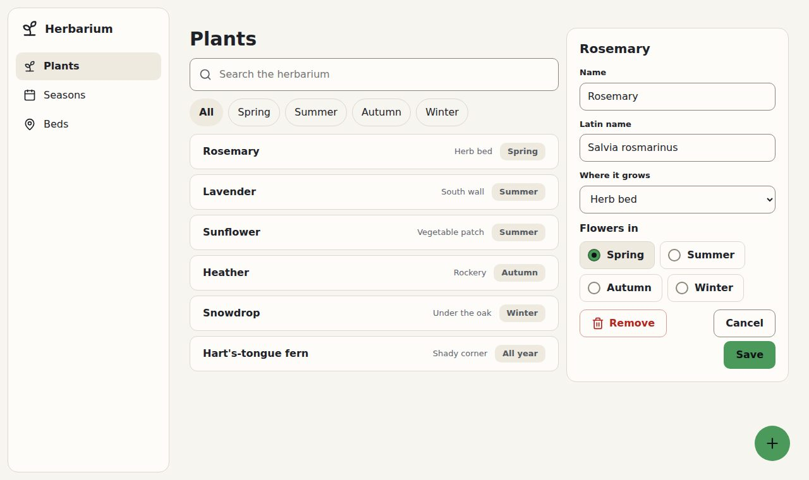

# 4. 📝 The sheet

**Goal:** a plant's sheet beside the list, to change its name, its bed and when it flowers.

## Side by side

Bubble gives the parts; the layout of your own screen is yours. Add a `<style>` to the `<head>`,
after the two CSS files:

```html
<style>
.herbarium { display: grid; grid-template-columns: minmax(0, 1fr) 26rem; gap: var(--gap); align-items: start; }
.herbarium > div { display: grid; gap: var(--gap); }
.pane { display: grid; gap: var(--gap); }
</style>
```

It uses `var(--gap)`, Bubble's distance between controls, so it follows the density later.

Make the page wide (`<main class="page wide">`) and wrap its content:
`<div class="herbarium"><div>` … the title, search, chips and list … `</div>` then the sheet,
then `</div>`.

## The sheet

```html
<section class="pane" aria-labelledby="sheet">
  <h2 id="sheet">Rosemary</h2>
  <div class="field"><label for="name">Name</label><input id="name" value="Rosemary"></div>
  <div class="field"><label for="latin">Latin name</label><input id="latin" value="Salvia rosmarinus"></div>
  <div class="field"><label for="bed">Where it grows</label>
    <select id="bed"><option>Herb bed</option><option>South wall</option><option>Rockery</option></select></div>
  <fieldset class="choices"><legend>Flowers in</legend>
    <label class="choice"><input type="radio" name="season" checked>Spring</label>
    <label class="choice"><input type="radio" name="season">Summer</label>
    <label class="choice"><input type="radio" name="season">Autumn</label>
    <label class="choice"><input type="radio" name="season">Winter</label>
  </fieldset>
  <div class="dialog-actions">
    <button class="button danger" type="button">Remove</button>
    <button class="button" type="button">Cancel</button>
    <button class="button primary" type="button">Save</button>
  </div>
</section>
```

- `.pane` is a surface for a group of controls.
- `.field` is a label over its control. Its edge lights up while you type.
- `.choices` and `.choice` turn radio buttons into pills a finger can hit.
- `.dialog-actions` puts the buttons at the end, and the first one, here the dangerous one, apart.

Last, a floating button to add a plant, just before `</body>`:

```html
<button class="fab" type="button" aria-label="New plant">+</button>
```

## ✅ Checkpoint

**You should see** the sheet on the right and the green `+` at the bottom corner:



Press Tab a few times. A ring follows the keyboard from control to control, in the green. The
finished file is `4-the-sheet.html`.

## What you learned

- Fields, choices and buttons are plain HTML controls with a Bubble class.
- Your own layout uses Bubble's tokens (`var(--gap)`) so it changes with the theme.

Next: 🌙 [Level 5: night and density](5-night-and-density.md)
