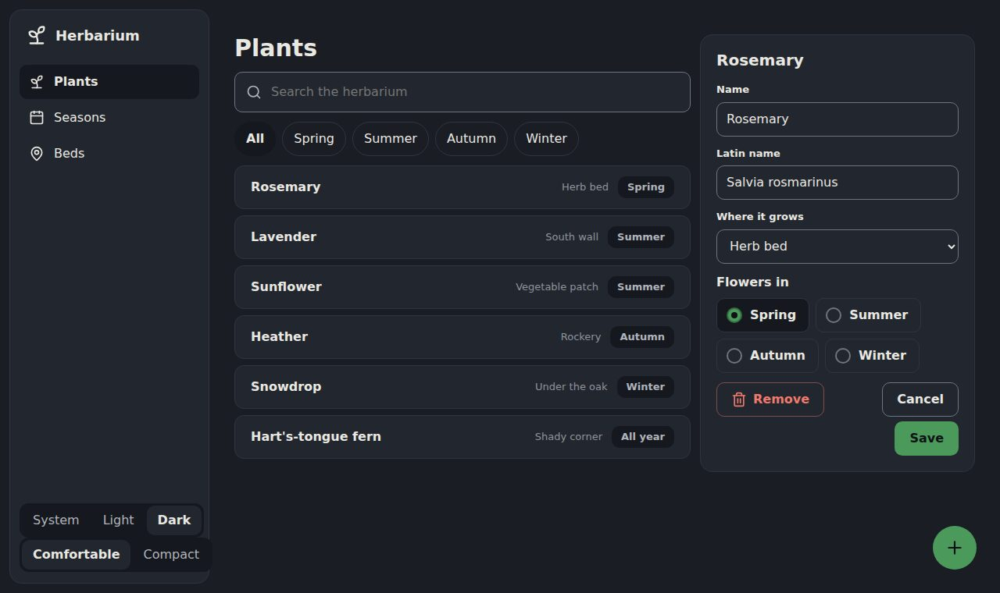
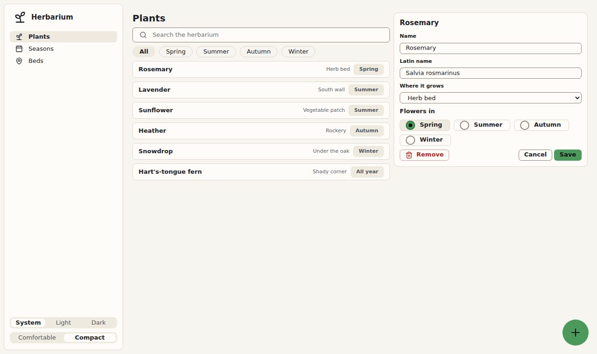

# 5. 🌙 Night and density

**Goal:** a switch in the index for light or dark, and for a comfortable or compact view.

## Attributes on `<html>`

`tokens.css` already holds every theme. The page picks one with attributes on `<html>`:

| Attribute | Values | Without it |
|---|---|---|
| `data-mode` | `light`, `dark` | the system's choice |
| `data-density` | `compact` | comfortable |
| `data-style` | `material` | paper |
| `data-glass` | (no value) | opaque |

Try it by hand first: write `<html lang="en" data-mode="dark">` and reload. Then take it out again.

## The switch

At the end of the `.sidebar`, add its foot with two segmented controls:

```html
<div class="sidebar-foot">
  <div class="segmented" role="radiogroup" aria-label="Mode">
    <label><input type="radio" name="mode" value="" checked>System</label>
    <label><input type="radio" name="mode" value="light">Light</label>
    <label><input type="radio" name="mode" value="dark">Dark</label>
  </div>
  <div class="segmented" role="radiogroup" aria-label="Density">
    <label><input type="radio" name="density" value="" checked>Comfortable</label>
    <label><input type="radio" name="density" value="compact">Compact</label>
  </div>
</div>
```

And before `</body>`, a few lines that turn each choice into its attribute:

```html
<script>
const root = document.documentElement
document.querySelectorAll("input[name=mode], input[name=density]").forEach(input => {
  input.addEventListener("change", () => input.value
    ? root.setAttribute("data-" + input.name, input.value)
    : root.removeAttribute("data-" + input.name))
})
</script>
```

In the index, the two controls fit better as one line each. Add to your `<style>`:

```css
.sidebar-foot { display: grid; gap: 8px; }
.sidebar-foot .segmented { display: flex; }
.sidebar-foot .segmented label { flex: 1; justify-content: center; padding-inline: 6px; }
```

## ✅ Checkpoint

Choose *Dark*. **You should see** the slate night of the logos. The green stays as it was: it already
stands out from the night.



Choose *Compact*: the same screen, tighter, for a mouse.



The finished file is `5-night-and-density.html`. It also reads `?mode=dark` from the address.

## What you learned

- One attribute changes the whole theme; no part has to know.
- "System" is simply no attribute: Bubble follows the system's dark mode on its own.

Next: 🧊 [Level 6: glass](6-glass.md)
