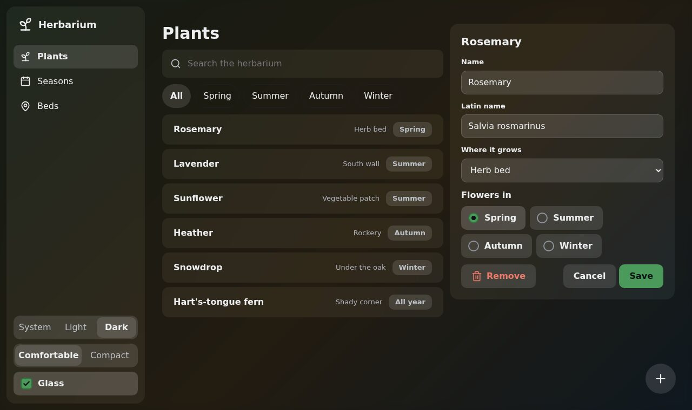

# 6. 🧊 Glass

**Goal:** the herbarium as frosted panes over a soft light, then over a wallpaper.

## Turn it on

Glass is a finish of paper. Add `data-glass` to `<html>`:

```html
<html lang="en" data-glass>
```

The index, the list and the sheet become translucent panes over two soft lights. Their text keeps
its contrast: the tests check it over each light.

## A wallpaper

Glass can show any picture or gradient behind the panes. Give it one in `--wallpaper`, on
`<html>`, and add the element that draws it as the first thing in `<body>`:

```html
<html lang="en" data-glass style="--wallpaper: linear-gradient(135deg, #7FB77E, #F6BD60 55%, #4FA3E0)">
…
<body>
<div class="wallpaper"></div>
```

Bubble blurs it, dims it and lays a veil over it, so the text still reads whatever the picture is.
A photo works too: `--wallpaper: url(garden.jpg)`.

## A switch for it

Add a check box to the sidebar's foot, and two lines to the script:

```html
<label class="choice"><input type="checkbox" name="glass">Glass</label>
```

```js
const glass = document.querySelector("input[name=glass]")
glass.addEventListener("change", () => root.toggleAttribute("data-glass", glass.checked))
```

## ✅ Checkpoint

**You should see** the panes over the gradient, by day and at night:




If the system asks for less transparency, glass turns opaque again by itself. The finished file is
`6-glass.html`.

## What you learned

- `data-glass` and a `.wallpaper` are all glass needs.
- Bubble keeps text readable over a picture it has never seen.

Next: 🖥️ [Level 7: to the desktop](7-to-the-desktop.md)
