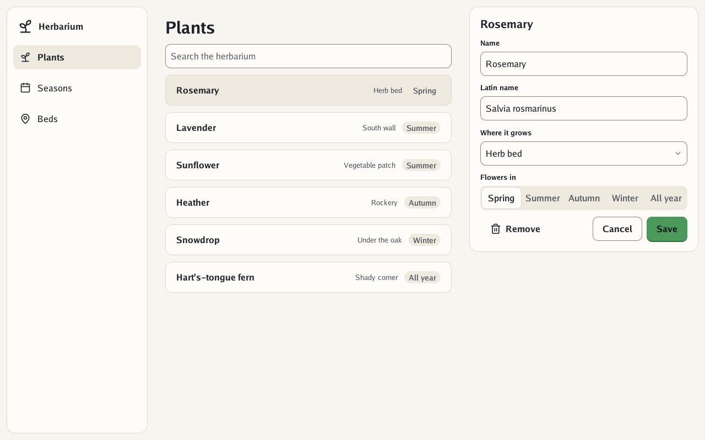
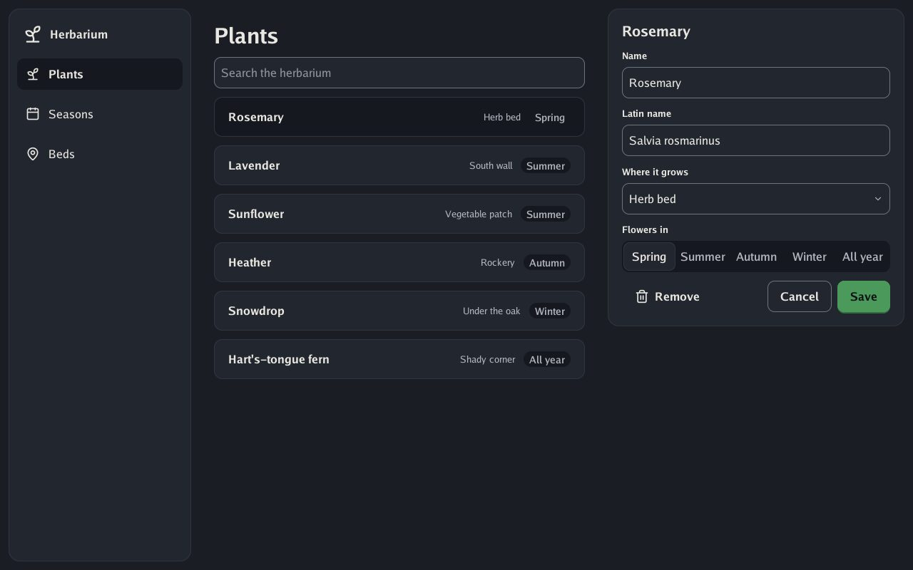
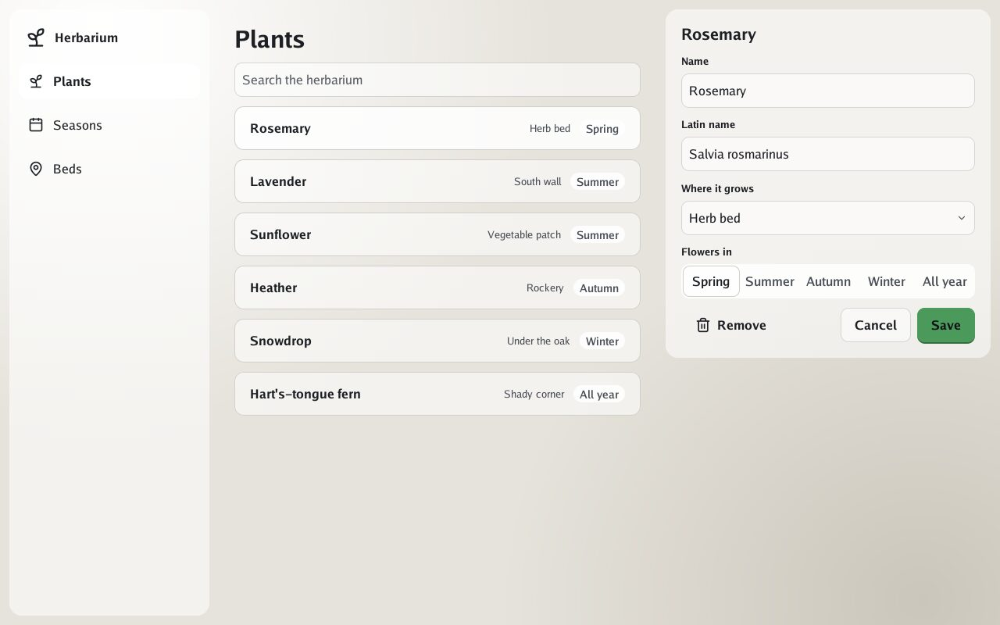

# 7. 🖥️ To the desktop

**Goal:** the herbarium as a Go program, drawn by [Go UI](https://github.com/akrck02/go-ui),
looking like the web page.

This level is in Go. If you have not run Go UI before, do
[getting started's third step](../2-getting-started.md#3-the-same-look-in-a-go-window) first: it
clones Go UI and Go Renderer next to Bubble.

## The program

The finished program is `goui/examples/herbarium/main.go`. Run it from Bubble's `goui` folder:

```sh
cd bubble/goui
go run ./examples/herbarium
```

**You should see** the herbarium in a window. Click a plant: its sheet opens. Type in the search:
the list narrows.



## Where Bubble comes in

Only one function knows about Bubble. It makes the theme from the four choices, as `tokens.css`
did, and turns it into Go UI's:

```go
// newHerbarium makes Bubble's theme from the four choices and turns it into go-ui's.
func newHerbarium(style bubble.Style, glass bool, options window.Options) (*herbarium, error) {
	colour, err := bubble.ParseColor(accent)
	if err != nil {
		return nil, err
	}
	mode := bubble.ModeLight
	if options.Dark {
		mode = bubble.ModeDark
	}
	theme, err := bubble.NewTheme(bubble.Options{Style: style, Mode: mode, Density: bubble.DensityComfortable, Accent: colour, Glass: glass})
	if err != nil {
		return nil, err
	}
	garden := &herbarium{design: theme, theme: goui.Theme(theme), plants: []plant{
		{"Rosemary", "Salvia rosmarinus", "Herb bed", 0},
		{"Lavender", "Lavandula angustifolia", "South wall", 1},
		{"Sunflower", "Helianthus annuus", "Vegetable patch", 1},
		{"Heather", "Calluna vulgaris", "Rockery", 2},
		{"Snowdrop", "Galanthus nivalis", "Under the oak", 3},
		{"Hart's-tongue fern", "Asplenium scolopendrium", "Shady corner", 4},
	}}
	if theme.Glass.Enabled {
		garden.ground = draw2d.NewImage(goui.Ground(theme, options.Width, options.Height))
	}
	return garden, nil
}
```

Then, at the start of every frame, the program hands the theme to Go UI:

```go
func (garden *herbarium) draw(context *ui.Context) {
	context.Theme = garden.theme
	if garden.ground == nil {
		garden.frame(context)
		return
	}
	// On glass the ground is a picture, and the whole screen a layer of panes over it.
	width, height := context.Size()
	context.Image(garden.ground, ui.Layout{Width: ui.Grow(), Height: ui.Grow()}, 0)
	context.Overlay("screen", ui.LayerOptions{Width: ui.Fixed(width), Height: ui.Fixed(height)}, func() { garden.frame(context) })
}
```

Everything else is ordinary Go UI: `Selectable` for the places, `TextFieldWith` for the search and
the fields, `Select` for the bed, `Tabs` for the season, `PrimaryButton` to save. They wear Bubble
because the theme says so.

## Parts Go UI does not have

A few of Bubble's parts have no control of their own in Go UI: the `.pane`, or a `.list-item`
that opens a sheet. The program draws them with Go UI's `Frame` and `Clickable`, reading the
theme's values, as Bubble's CSS does in each style:

```go
// pane is Bubble's .pane: a surface with a fine line on paper, a pane of glass on glass, and on
// Material a tinted surface that floats.
func (garden *herbarium) pane(context *ui.Context, layout ui.Layout, content func()) {
	theme := context.Theme
	context.Frame(layout, garden.surface(theme.PanelRadius), content)
}

// materialTint is how much accent tint Bubble's CSS mixes into a Material card.
const materialTint = 0.45

// surface is how Bubble's CSS draws a card or a pane in the theme's style, with the given corners.
func (garden *herbarium) surface(radius float32) ui.Look {
	theme, colours := garden.theme, garden.design.Colors
	switch {
	case garden.ground != nil:
		return ui.Look{Fill: theme.Surface, Radius: radius}
	case garden.design.Options.Style == bubble.StyleMaterial:
		tinted := colours.Surface.Mix(colours.AccentTint, materialTint)
		return ui.Look{Fill: draw2d.MustHex(tinted.Hex()), Radius: radius, Shadow: true}
	default:
		return ui.Look{Fill: theme.Surface, Border: theme.Line, BorderWidth: 1, Radius: radius}
	}
}
```

Where Go UI's theme has no name for a value, such as a card's corners, the program keeps Bubble's
whole theme too and reads it there: `garden.design.Shape.CardRadius`.

## ✅ Checkpoint

Try the other looks:

```sh
go run ./examples/herbarium -dark
go run ./examples/herbarium -glass
```





## What you learned

- `bubble.NewTheme` makes the theme; `goui.Theme` dresses Go UI in it.
- Parts that Go UI lacks are drawn from the same values, so the two worlds still match.
- The [Go UI guide](../5-guides/4-go-ui.md) compares the browser and Go side by side.

Next: 🤖 [Level 8: Material](8-material.md)
