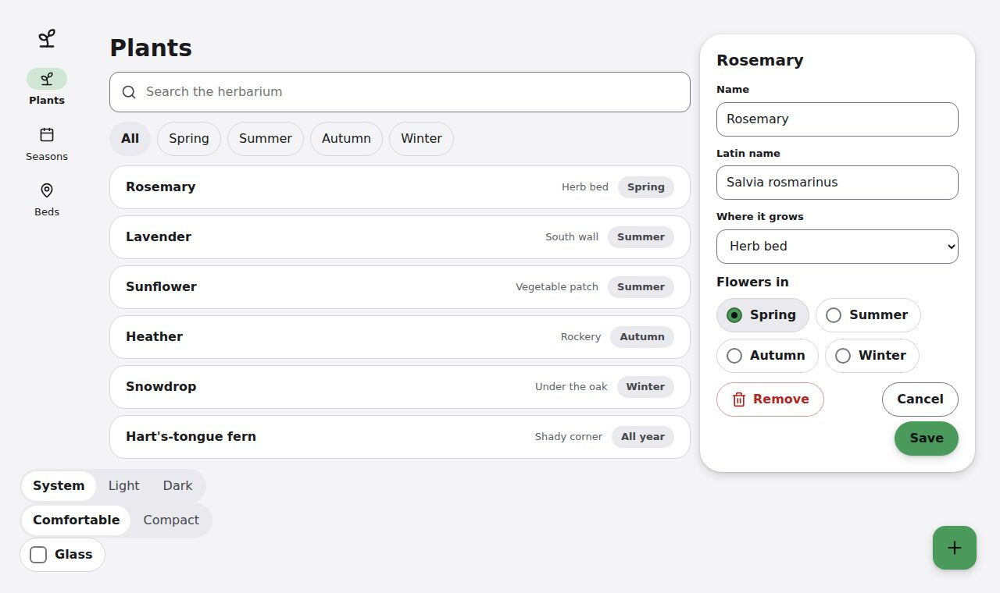
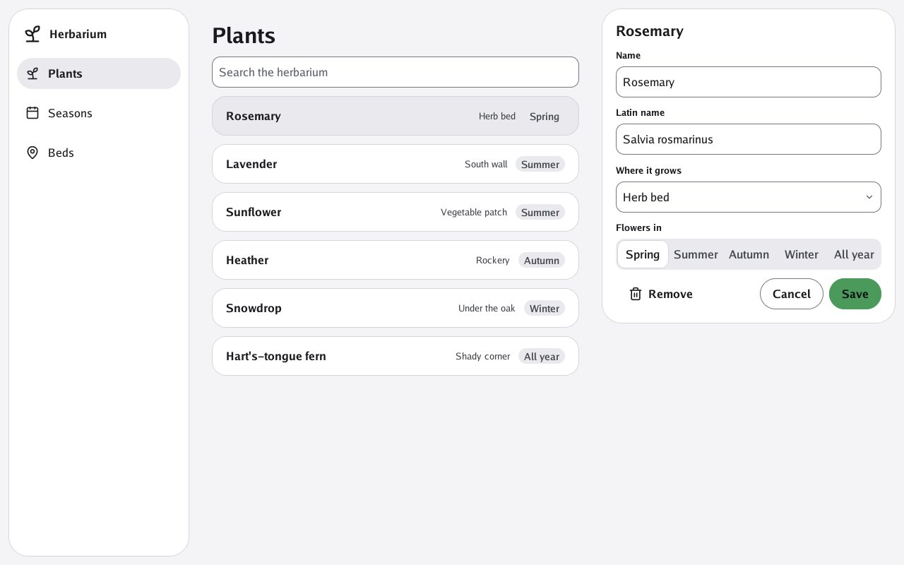

# 8. 🤖 Material

**Goal:** the herbarium in Material, the look Android users know, without touching its parts.

## On the web

Add one attribute:

```html
<html lang="en" data-style="material">
```

The finished page also takes it from the address: open `6-glass.html?style=material`.



What changed, and what did not:

| Changed | The same |
|---|---|
| buttons and chips are pills | every class in the HTML |
| cards are tinted with the accent and float | the green, adjusted the same way |
| the index becomes a rail of icons | light, dark and the densities |

## In Go

```sh
go run ./examples/herbarium -style material
```



In the program it is one field: `Style: bubble.StyleMaterial`.

## What is coming

Material is more than a look. Android apps also share their parts: a navigation bar at the
bottom, snackbars, dialogs, carousels. Those parts are moving into Bubble from Go UI for Android,
as controls that read Bubble's theme, so they will work in paper and glass too.
[Material's components](../5-guides/5-material-components.md) follows that work.

## 🏁 The end of the quest

You built one app, in two technologies and four looks, from one set of tokens. From here:

- [The guides](../5-guides/1-the-accent.md) go deeper into each choice.
- [The reference](../6-reference/2-components.md) lists every part and every token.
- [Contributing](../8-contributing.md) shows how to add a part of your own to Bubble.
