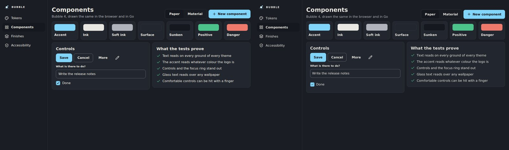
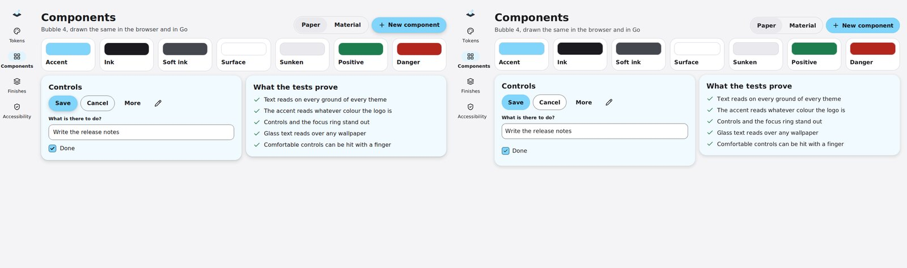

# Drawing go-ui in Bubble

[go-ui](https://github.com/akrck02/go-ui) draws interfaces in Go, over a go-renderer window. Its
theme has a token for everything a design system decides, and module `goui` fills them from a
Bubble theme, so **every go-ui control wears Bubble** and a screen looks the same in a browser and
in a go-ui window.

`goui` is a module of its own (`goui/go.mod`): Bubble's package stays free of go-ui, so making CSS
needs nothing of it, and go-ui knows nothing of Bubble.

> **Status:** in development, like Bubble 4 itself. `goui` needs go-ui and go-renderer on their
> `main` cloned next to Bubble, since go-ui still reaches go-renderer through a local copy.

## The shortest way

```go
import (
	"github.com/akrck02/bubble"
	"github.com/akrck02/bubble/goui"
)

accent, _ := bubble.ParseColor("#81D4FA") // the main colour of your logo
theme, err := bubble.NewTheme(bubble.Options{
	Style: bubble.StylePaper, Mode: bubble.ModeLight,
	Density: bubble.DensityComfortable, Accent: accent,
})
if err != nil {
	return err
}
context.Theme = goui.Theme(theme) // before the first control of the frame
```

Buttons, lists, fields and check boxes now follow Bubble: the main button on its edge, what is
chosen brighter and never coloured, Bubble's line heights and drawn check box.

The focus follows Bubble too. It shows only when the keyboard brought it, as a ring on the
control's edge with no gap: inside the main button, in the colour of its text. A field lights its
own edge while it is typed in, and a held button shrinks to 0.97. go-ui only reads Tab, Enter and
Space while the interface has the keyboard, so a 3D view keeps them. A program that is only an
interface sets `context.KeyboardNavigation = ui.Always`. If the system asks for less motion, set
`context.LessMotion` and held buttons keep their size.

## The same screen, twice

`goui/cmd/showcase` is one screen written twice: with go-ui (`main.go`) and in HTML with Bubble's
CSS (`web.html`). On the left of each pair the browser, on the right go-ui:







Between 4 and 6 % of the pixels differ, mostly along the edges of letters, where each engine
smooths text its own way. To draw the pairs again and count them:

```bash
goui/cmd/showcase/compare.sh pictures/   # needs go-ui and go-renderer next to Bubble, Chrome, ImageMagick
```

It prints one line per style and finish, such as `glass-dark: 3.8% of pixels differ`, and leaves the
pairs in `pictures/side-*.png`.

Three differences are on purpose, or still to do:

- **A check box's row is 44 pixels tall** in go-ui, a finger's size, as Bubble asks of touch
  targets; the web page lets the box alone be the target.
- **A secondary button** is filled with the surface in go-ui and clear in the browser: on
  Material's tinted cards it shows.
- **A text field** keeps its text a little closer to the edge in go-ui.

## Glass

Ask Bubble for glass and paint its ground under the interface, the window's size:

```go
theme, _ := bubble.NewTheme(bubble.Options{Style: bubble.StylePaper, Mode: bubble.ModeDark,
	Density: bubble.DensityComfortable, Accent: accent, Glass: true})
ground := draw2d.NewImage(goui.Ground(theme, width, height)) // once

window.Run(options, func(context *ui.Context) {
	context.Theme = goui.Theme(theme)
	context.Image(ground, ui.Layout{Width: ui.Grow(), Height: ui.Grow()}, 0)
	context.Overlay("screen", ui.LayerOptions{Width: ui.Fixed(width), Height: ui.Fixed(height)}, func() {
		// the interface, over the ground
	})
})
```

`goui.Theme` makes surfaces and wells the translucent panes, as Bubble's CSS does, and sets go-ui's
`BackdropBlur` to glass's blur: every pane blurs what is behind it, as CSS's `backdrop-filter`. Over
glass's own smooth ground it hardly shows; over a picture it does. To see it, draw the showcase
over sharp stripes:

```bash
cd goui && go run ./cmd/showcase -glass -dark -stripes
```

Under each pane the stripes turn into a soft grey. go-renderer takes one snapshot of the frame per
layer and blurs it small; its guide to the overlay measures what that costs. Over a 3D scene,
Metal does not blur yet: the panes show unblurred there.
