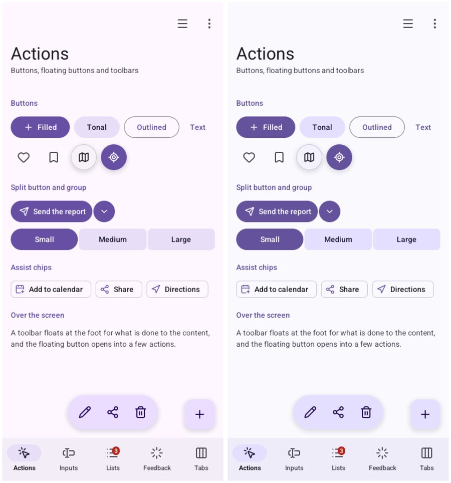
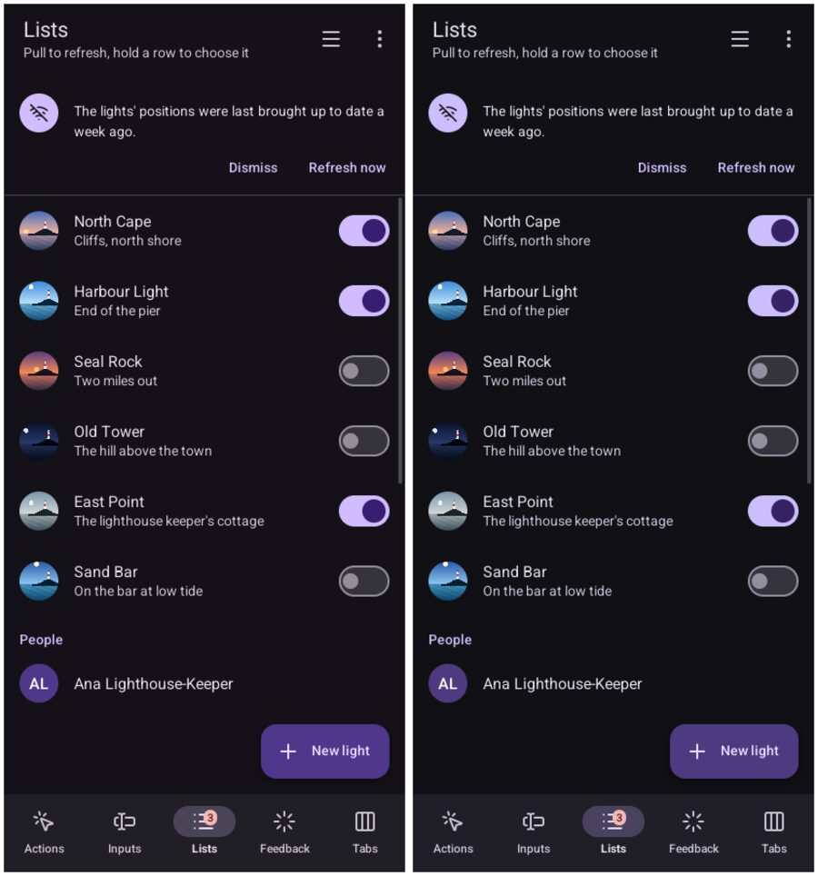

# 🤖 Material's components

This page is for someone who wants Android's look, Material 3, in a Go interface or a web page. At
the end you will know how to turn it on, how to draw Material's parts in Go, and how a phone's
wallpaper colours them.

> **Status:** in development, like Bubble 4. The parts came from
> [Go UI for Android](https://github.com/akrck02/go-ui-android), where they were written; they now
> live here, and read a Bubble theme.

## The idea

Material makes all its colours from one: a **seed**. The seed becomes tonal palettes, its hue at
every lightness. Material's roles (the primary, its container, the surfaces) are fixed shades of
those palettes. Android makes the palettes from the phone's wallpaper, and that is why its
applications take the wallpaper's colours.

Bubble does the same with your accent. With `Style: bubble.StyleMaterial`:

- **Colours:** the accent is the seed. The colours come out as Go UI for Android made them; a test
  compares them with that package's output.
- **Surfaces:** they are told apart by tone, on a ladder of containers (`ContainerLow`,
  `Container`, `ContainerHigh` and `ContainerHighest`), not by lines. Paper and glass have the
  ladder too, made from their own colours.
- **Sizes:** 48-pixel controls and Material's type scale, in Roboto.

## In a web page

Put the style on `<html>`; Bubble's CSS does the rest:

```html
<html data-style="material">
```

Fields become filled, with a line under them. Cards and panes sit on the low container, with no
line. Labels are of a medium weight, and the main button is flat. A **tonal** button sits between
the main one and an outline, for an action repeated in a list:

```html
<button class="button tonal" type="button">Sell one</button>
```

On paper and glass the tonal button is a sunken fill in ink, so the accent stays for the main
action. In Material it takes the accent's tint, as Android does.

## In Go: Material's parts

Package `bubble/goui/material` has Material 3's parts for Go UI:

- navigation bars, rails and drawers, tabs and swiping pages;
- every kind of button, floating buttons, split buttons and groups;
- switches, check boxes, segmented buttons and sliders;
- chips, filled fields and the search bar;
- cards, list items and banners;
- dialogs, sheets, snackbars and menus;
- date and time pickers, progress indicators, pull to refresh and carousels.

```go
package main

import (
	"fmt"
	"log"

	"github.com/akrck02/bubble"
	"github.com/akrck02/bubble/goui"
	"github.com/akrck02/bubble/goui/material"
	"github.com/akrck02/go-renderer/draw2d"
	ui "github.com/akrck02/go-ui"
	"github.com/akrck02/go-ui/window"
)

func main() {
	accent, err := bubble.ParseColor("#2C5C9E")
	if err != nil {
		log.Fatal(err)
	}
	theme, err := bubble.NewTheme(bubble.Options{Style: bubble.StyleMaterial, Mode: bubble.ModeLight,
		Density: bubble.DensityComfortable, Accent: accent})
	if err != nil {
		log.Fatal(err)
	}
	options := window.Options{Title: "Lighthouses", Width: 412, Height: 892}
	options.Fonts = goui.FontsFor(theme.Options.Style) // Roboto, for the window to draw in
	lights := 0
	err = window.Run(options, func(context *ui.Context) {
		context.Theme = goui.Theme(theme)
		look := material.New(context, theme)
		look.TopAppBar(material.TopBar{Title: "Lighthouses"})
		if look.FilledButton("plus", "New light") {
			lights++
		}
		look.Text(fmt.Sprintf("%d lights", lights), 16, draw2d.Regular, look.Roles.OnSurface)
	})
	if err != nil {
		log.Fatal(err)
	}
}
```

It opens a phone-sized window in Material with a top bar, a filled button and a count of the
lights it added. It is `goui/examples/lighthouses`: `cd goui && go run ./examples/lighthouses`.

The parts read the theme through `material.Roles`, Material's names for Bubble's colours. So the
same parts draw in paper and glass too: give `material.New` a paper theme and they follow it.

## The gallery

`goui/cmd/gallery` shows every part, one screen per part of Material's catalogue:

```bash
cd goui && go run ./cmd/gallery                # Material, in a phone-sized window
cd goui && go run ./cmd/gallery -style paper   # the same parts on paper
```

Go UI for Android's gallery is the look to keep. `goui/cmd/gallery/reference/` holds its screens,
and `compare.sh` draws Bubble's beside them. It prints how much differs: about 2 to 4 % on most
screens, mostly antialiasing. Actions differ by up to 13 % and Tabs by 18 %: the first because the
background is computed from Material's purple rather than written by hand, the second because the
film card was left out.





## On a phone

A phone made its palettes from the wallpaper. Go for Android reads them and gives them to Bubble
in `Options.Palettes`, and they take the place of the accent:

```go
palettes := bubble.PalettesFromColor(seed) // or the phone's, from Go for Android
theme, _ := bubble.NewTheme(bubble.Options{Style: bubble.StyleMaterial, Mode: bubble.ModeDark,
	Density: bubble.DensityComfortable, Accent: accent, Palettes: &palettes})
```

Bubble itself knows nothing of Android: what reads the system stays in Go for Android.
