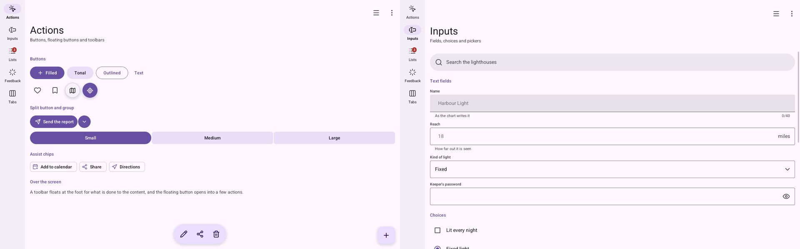

# 🤖 Material's components (coming)

This page is for someone waiting for Material's parts in Go. It says what is coming and where it
stands. Nothing here can be used yet.

## What exists today

Bubble's **material style** is a first step: pill buttons, tinted cards that float, a rail of
icons for the index. Fields, lists, type and surfaces are still paper's. Turn it on with `data-style="material"` or
`Style: bubble.StyleMaterial`.

## What is moving here

[Go UI for Android](https://github.com/akrck02/go-ui-android) has a `material` package with
Material 3's own parts for Go UI. They are moving into Bubble:

| From Go UI for Android | Goes to | Why |
|---|---|---|
| the colour scheme, seed colours, the theme | Bubble's material style | they are tokens; Bubble already makes them |
| navigation bars and rails, drawers, dialogs, snackbars, chips, carousels, pickers, pull to refresh | `bubble/goui`, as controls | they are parts; reading Bubble's theme, they work in paper and glass too |
| the system's colours, drawing under the system bars, the back gesture | Go for Android (the renamed Go UI for Android) | they are Android, not design |

## The look to reach

Go UI for Android's Material is the reference: Bubble's material style is done when it looks like
this gallery, compared side by side as the showcase compares the browser and Go.

## What the parts will look like

Each part will be a control that reads Bubble's theme, next to `goui.Theme`. Its name and options
will be written here when they exist. Until then, follow the work in
[Go UI for Android](https://github.com/akrck02/go-ui-android) and in Bubble's `feature/v4` branch.
