# 🧩 Components

Every part of `css/bubble.css`: what it is for, its HTML, and how it looks on paper, by day. Load `tokens.css` first. This page is made by `docs/6-reference/components.py`; do not edit it by hand.

## Buttons

Actions. A screen has one primary button, its main action.

```html
<button class="button primary" type="button">Save</button>
<button class="button" type="button">Cancel</button>
<button class="button tonal" type="button">Sell one</button>
<button class="button ghost" type="button">More</button>
<button class="button danger" type="button">Remove</button>
<button class="button ghost icon" type="button" aria-label="Add"><svg aria-hidden="true" width="20" height="20" viewBox="0 0 24 24" fill="none" stroke="currentColor" stroke-width="2" stroke-linecap="round"><path d="M5 12h14"/><path d="M12 5v14"/></svg></button>
```

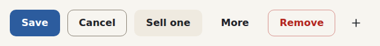

- `.primary` stands on its darker edge, and sinks onto it when pressed.
- `.tonal` is for an action repeated in a list: a sunken fill in ink, the accent's tint in Material.
- `.ghost` has no border; `.icon` is square, a finger wide, and needs an `aria-label`.
- `.danger` is for actions that lose something. It is never filled.

## Fields

A label over its control: inputs, text areas and selects.

```html
<div class="field">
  <label for="name">Name</label>
  <input id="name" value="Rosemary">
</div>
<div class="field">
  <label for="bed">Where it grows</label>
  <select id="bed"><option>Herb bed</option><option>Rockery</option></select>
</div>
<div class="field">
  <label for="note">Note</label>
  <input id="note" aria-invalid="true" aria-describedby="note-error" value="">
  <p class="error" id="note-error">Write a note of a few words.</p>
</div>
```

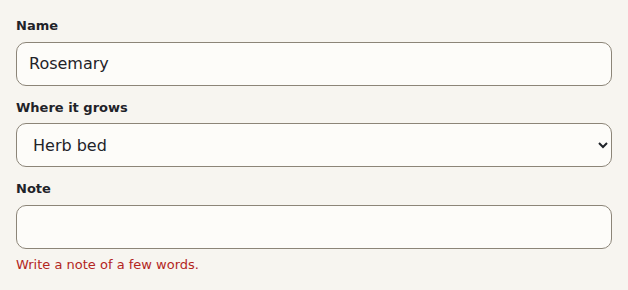

- The field's own edge lights up while it is written in.
- An `.error` under the control says what is wrong; tie it with `aria-describedby`.

## Check boxes and radio buttons

Plain `<input>`s, drawn by Bubble at a size a finger can hit.

```html
<label><input type="checkbox" checked> Done</label>
<label><input type="checkbox"> Watered</label>
<label><input type="radio" name="light" checked> Sun</label>
<label><input type="radio" name="light"> Shade</label>
```

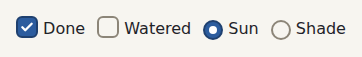

- Checked, they wear the accent with its darker edge, as the primary button does.

## Choices

One choice of a few, or several, as pills in a named group.

```html
<fieldset class="choices">
  <legend>Flowers in</legend>
  <label class="choice"><input type="radio" name="season" checked>Spring</label>
  <label class="choice"><input type="radio" name="season">Summer</label>
  <label class="choice"><input type="radio" name="season">Autumn</label>
</fieldset>
```

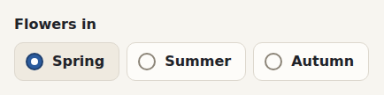

- The whole pill takes the focus ring.
- Check boxes work the same, for several choices.

## Segmented control

A few options side by side, the chosen one raised: views, modes.

```html
<div class="segmented" role="radiogroup" aria-label="Mode">
  <label><input type="radio" name="mode" checked>Light</label>
  <label><input type="radio" name="mode">Dark</label>
  <label><input type="radio" name="mode">System</label>
</div>
```

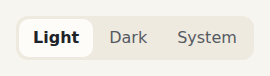

- It can also hold links or buttons: `<a class="button ghost" aria-current="page">`.

## Chips

Filters for what a page shows.

```html
<nav class="chips" aria-label="Seasons">
  <a class="chip" href="#" aria-current="page">All</a>
  <a class="chip" href="#">Spring</a>
  <a class="chip" href="#">Summer</a>
</nav>
```

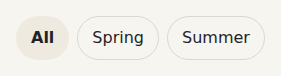

- The chosen chip is brighter and heavier, never coloured.

## Cards, panes and pills

Surfaces that group things, and small labels.

```html
<section class="card">
  <h2>Rosemary</h2>
  <p class="quiet">Salvia rosmarinus · <span class="pill">Spring</span></p>
</section>
<section class="pane">
  <h2>Today</h2>
  <p class="soft">Water the herb bed.</p>
</section>
```

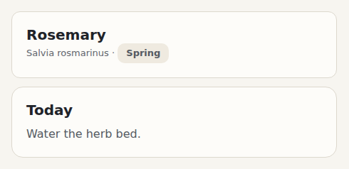

- `.card` is one thing; `.pane` holds a group on a page.
- On Material, cards are tinted and both float instead of having a line.

## Lists and rows

Things one under another: big items, or rows inside a pane.

```html
<ul class="list">
  <li class="list-item"><span class="title">Rosemary</span><span class="pill">Spring</span></li>
  <li class="list-item done"><span class="title">Sunflower</span><span class="pill">Summer</span></li>
</ul>
<ul class="rows">
  <li class="row"><input type="checkbox" aria-label="Done"><span class="title">Prune the lavender</span><span class="time">09:30</span></li>
  <li class="row done"><input type="checkbox" checked aria-label="Done"><span class="title">Sow the beans</span><span class="time">08:00</span></li>
</ul>
```

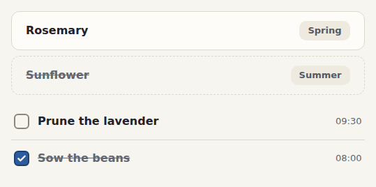

- `.title` takes the room that is left.
- `.done` crosses an item out and quiets it.

## Search

A box with an icon, and results to choose with the arrows.

```html
<div class="search" role="search">
  <label class="search-box"><svg aria-hidden="true" width="20" height="20" viewBox="0 0 24 24" fill="none" stroke="currentColor" stroke-width="2" stroke-linecap="round"><circle cx="11" cy="11" r="8"/><path d="m21 21-4.34-4.34"/></svg><input type="search" aria-label="Search" value="ros"></label>
  <ul class="search-results" role="listbox">
    <li class="search-result" role="option" aria-selected="true"><span class="title">Rosemary</span><span class="pill">Plant</span></li>
    <li class="search-result" role="option"><span class="title">Rose bed</span><span class="pill">Bed</span></li>
  </ul>
</div>
```

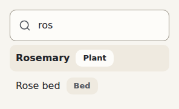

- Moving the choice with the arrows, and opening it with Enter, is your script's: it is an ARIA combobox.

## Empty state

What will be here, and how to make the first one.

```html
<div class="empty">
  <p>No plants yet. Add the first one and give it a sheet.</p>
  <button class="button primary" type="button">New plant</button>
</div>
```

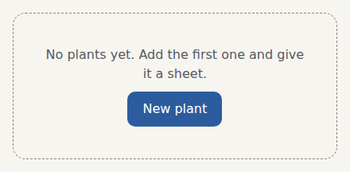

## Colour swatches

A colour beside its name, or round swatches to choose one.

```html
<p><span class="swatch" style="background: #4C9A5B"></span> Green</p>
<fieldset class="swatches">
  <legend class="visually-hidden">Colour</legend>
  <label class="swatch-choice" style="--swatch: #4C9A5B"><input type="radio" name="c" checked aria-label="Green"></label>
  <label class="swatch-choice" style="--swatch: #F6BD60"><input type="radio" name="c" aria-label="Gold"></label>
  <label class="swatch-choice" style="--swatch: #4FA3E0"><input type="radio" name="c" aria-label="Blue"></label>
</fieldset>
```

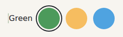

- The name, not the colour, is what is read out.

## Keys

A key of the keyboard, as in a shortcut.

```html
<p>Search with <kbd class="key">Ctrl</kbd> <kbd class="key">K</kbd></p>
```

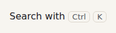

## The frame and the rest

Bigger parts, shown at work in the quest rather than alone:

| Part | Classes | What it is for |
|---|---|---|
| App frame | `.app` > `.sidebar` + `.page` | The index on the left and the page; under 1024 pixels the index folds to icons, under 640 a `.bottom-bar` takes its place. See [the quest's level 3](../4-the-quest/3-the-index.md). |
| Brand | `.brand` | The app's logo and name, at the top of the index. |
| Places | `.places` > `a[aria-current=page]` | The app's places; Material turns them into a rail of icons. |
| Sidebar foot | `.sidebar-foot` | What stays at the bottom of the index: settings, the search. |
| Page | `.page`, `.page.wide` | A column of reading width; `.wide` for grids and calendars. |
| Floating button | `.fab` | The main thing to create, always within reach, at the bottom corner. |
| Dialog | `<dialog class="dialog">` > `form` > `.dialog-fields` + `.dialog-actions` | Open it with `showModal()`: the browser keeps the focus inside and closes it on Escape. |
| Finish cards | `.finishes` > `label.finish` > `input` + `.preview` + `.note` | A choice shown as a card with a picture of itself, such as Paper or Glass. |
| Wallpaper | `.wallpaper` | Draws `--wallpaper` behind glass. See [glass](../5-guides/3-glass.md). |
| Text | `.soft`, `.quiet`, `.visually-hidden` | Secondary text, captions, and text only screen readers read. |

## Every part, in every look

Each part reads only tokens, so the attributes on `<html>` change them all: `data-mode`, `data-density`, `data-style` and `data-glass`. See [the tokens](1-tokens.md).
